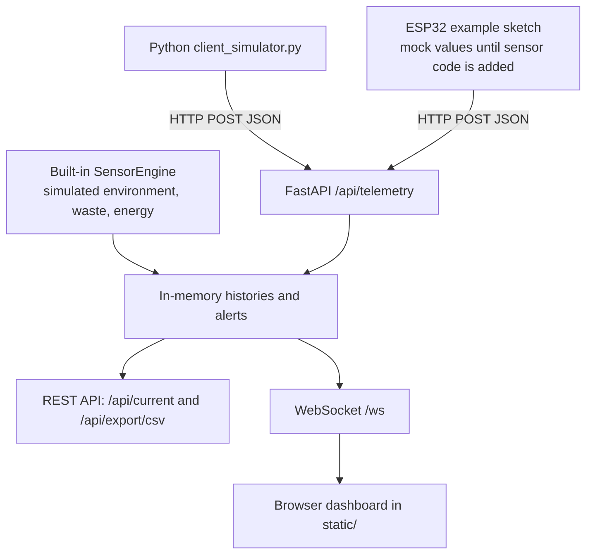

# EcoPulse Technical Design Document

## 1. Purpose and scope

EcoPulse is a prototype that combines simulated environmental telemetry with simulated waste-management and renewable-energy metrics. The backend implementation is in `server.py` and uses FastAPI, Pydantic models, an in-memory simulation engine, REST endpoints, and a WebSocket connection manager. A separate client simulator can submit environmental telemetry. An ESP32 sketch is included as an optional example, but its sensor values are currently mocked in the code.

## 2. Architecture

This is a code-oriented view of the supplied backend. The browser UI depends on the actual assets in `static/`. The ESP32 path is an example; the current sketch uses mock values rather than reading all the listed physical sensors.

## 3. Components

### 3.1 FastAPI application (`server.py`)

- Creates a FastAPI application named `EcoPulse - Smart Sustainability & Environmental Monitoring System`.
- Defines Pydantic models for environmental telemetry, waste-bin data, energy data, threshold configuration, and anomaly triggers.
- Creates a `SensorEngine` with predefined environmental presets, waste-bin state, energy state, alert history, and bounded in-memory histories.
- Generates simulated environmental and energy readings on a background asyncio task at a default interval of 1.5 seconds.
- Provides REST endpoints for current state, telemetry ingestion, simulation presets, anomaly triggers, simulation control, waste-bin emptying, threshold updates, and CSV export.
- Exposes a WebSocket endpoint at `/ws` for an initial state and live broadcasts.

### 3.2 Sensor simulation engine

The engine includes presets named `Standard Office`, `Server Room`, `Greenhouse`, `Industrial Factory`, and `Urban City`. It adds small random variations to readings and supports named anomaly scenarios such as heatwave, smoke, CO₂ spike, storm, bin overflow, methane leak, solar cloud, and grid blackout. The engine keeps up to 300 environmental history entries and 300 energy history entries in memory, and up to 100 alerts.

### 3.3 External Python client (`client_simulator.py`)

The client generates a JSON payload containing timestamp, temperature, humidity, AQI, PM2.5, PM10, CO₂, pressure, noise, light, and a source label. It sends the payload with HTTP POST to `http://127.0.0.1:8000/api/telemetry` every two seconds. A timeout is configured for each request; errors are printed to the console.

### 3.4 ESP32 example (`esp32_firmware_sample.ino`)

The sketch connects to Wi-Fi and posts JSON telemetry to a configured server URL. It contains placeholder Wi-Fi credentials and an example LAN URL. The measurements in the supplied sketch are generated/mock values; comments indicate where actual sensor readings should be integrated. Never commit actual Wi-Fi credentials to a public repository.

### 3.5 Frontend (`static/`)

The README describes a browser dashboard served from `static/index.html`. The directory must be included in the repository for the full interface. Its JavaScript is expected to communicate with the backend using the API/WebSocket interfaces; validate exact behavior against the actual frontend files.

## 4. Data model

The `TelemetryData` model defines:

| Field | Type | Meaning / unit documented in code |
|---|---|---|
| `timestamp` | string | ISO-style timestamp; defaults to current local time |
| `temperature` | float | degrees Celsius |
| `humidity` | float | relative humidity percent |
| `aqi` | integer | AQI, documented range 0–500 |
| `pm25` | float | µg/m³ |
| `pm10` | float | µg/m³ |
| `co2` | integer | ppm |
| `pressure` | float | hPa |
| `noise` | float | dB |
| `light` | integer | lux |
| `source` | string | source label; defaults to `simulated` |

Other models describe waste bins, energy metrics, threshold values, and anomaly requests. These values are prototype simulation data unless connected to real sensors.

## 5. Data flow

1. The `SensorEngine` generates environmental and energy values and updates waste-bin state.
2. Generated values are stored in bounded in-memory deques.
3. The background simulation task broadcasts current state to connected WebSocket clients.
4. The browser dashboard can receive those updates over `/ws` (verify the client implementation in `static/`).
5. The Python client or ESP32 example can POST telemetry to `/api/telemetry`.
6. REST clients can query `/api/current`, change simulation controls, update thresholds, or download CSV data from `/api/export/csv`.

## 6. API summary

| Method | Endpoint | Purpose |
|---|---|---|
| GET | `/api/current` | Current telemetry, energy, waste, alerts, preset, thresholds |
| POST | `/api/telemetry` | Accept telemetry validated by `TelemetryData` |
| POST | `/api/waste/empty` | Empty a waste bin by ID |
| POST | `/api/simulate/preset` | Select a known simulation preset |
| POST | `/api/simulate/anomaly` | Trigger an anomaly |
| POST | `/api/simulate/control` | Pause simulation or set interval |
| GET | `/api/export/csv` | Download telemetry/energy history as CSV |
| POST | `/api/thresholds` | Update threshold configuration |
| WebSocket | `/ws` | Initial state, live broadcasts, and client actions |
| GET | `/`, `/environmental`, `/waste`, `/renewable`, `/energy` | Serve dashboard HTML when available |

## 7. Configuration and environment variables

The supplied Python code does not read environment variables for its primary settings. The server runs on `127.0.0.1:8000` through `run.bat` and its `__main__` block. The client URL is a constant in `client_simulator.py`. The ESP32 sketch requires the user to edit `WIFI_SSID`, `WIFI_PASSWORD`, and `SERVER_URL` in the sketch. Keep real Wi-Fi credentials out of version control.

## 8. Error handling

- The Python client applies a 3-second HTTP request timeout and prints failures.
- FastAPI/Pydantic validates the telemetry model before the endpoint runs.
- Unknown waste-bin IDs return HTTP 404.
- Unknown simulation presets return HTTP 400.
- WebSocket disconnects are removed from the active connection list.
- The simulation loop catches and logs exceptions to keep the task running.

## 9. Security considerations

- The server's CORS configuration currently allows all origins and credentials. This should be reviewed before any public deployment.
- The development server uses reload mode; do not treat it as a production deployment configuration.
- Keep Wi-Fi credentials and other secrets out of Git history.
- Do not expose the local development server directly to the public internet without appropriate authentication, network controls, and deployment hardening.

## 10. Limitations and future work

- Simulation histories are stored in memory and are lost when the process stops.
- The ESP32 sketch uses mock readings rather than actual sensor drivers for the listed measurements.
- The Python client is configured for localhost by default; change its URL if the server is hosted elsewhere.
- Future work could add automated API tests, persistent storage, authentication, configuration via environment variables, real sensor drivers, and deployment-specific settings.
